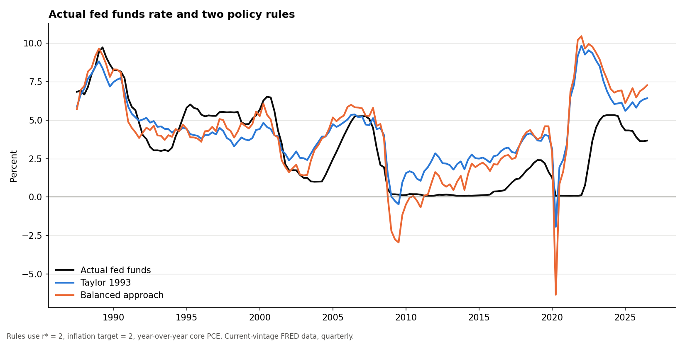
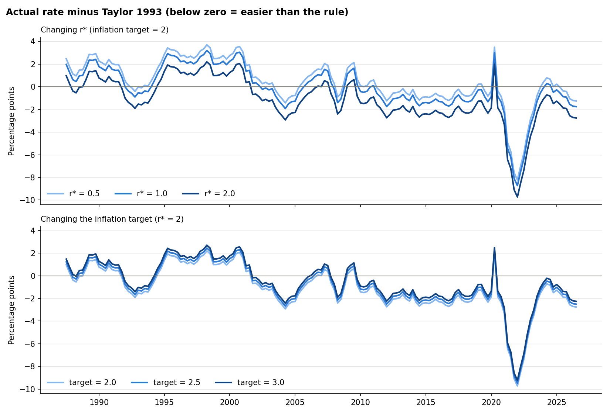

# How far has the Fed strayed from the Taylor rule?

This project compares the actual federal funds rate with two simple policy rules, every quarter from 1987Q3 to 2026Q3 (157 quarters), and asks how much the answer depends on numbers nobody can observe.

## What I found

With r* = 2 and a 2% inflation target, using FRED data downloaded on 2026-11-23:

| | Taylor 1993 | Balanced approach |
|---|---:|---:|
| Average gap, actual minus rule (pp) | -1.10 | -0.95 |
| Average size of gap, ignoring sign (pp) | 1.77 | 1.66 |
| Gap in 2026Q3 (pp) | -2.75 | -3.60 |
| Furthest below the rule (pp) | -9.72 (2022Q1) | -10.34 (2022Q1) |
| Furthest above the rule (pp) | 2.20 (1998Q2) | 6.41 (2020Q2) |
| Quarters where the rule is negative | 3 | 9 |

In 2026Q3 the funds rate averaged 3.67%, core PCE inflation was 3.05%, and the output gap was 1.70%. The rules gave 6.42% and 7.27%.

By period, average actual minus Taylor 1993 went from +0.50 pp (1987Q3 to 1999Q4) to -0.59 (2000 to 2007), -1.68 (2008 to 2015), -2.10 (2016 to 2019), -3.77 (2020 to 2021) and -3.25 (2022Q1 to 2026Q3).

The result is sensitive. Lowering r* from 2.0 to 0.5 turns the full-period average from -1.10 to +0.40 pp, so even its sign changes. The 2026Q3 gap shrinks from -2.75 to -1.25 pp. Raising the inflation target from 2 to 3 with r* = 2 moves the full-period average only to -0.60. The 2022Q1 gap is large under every setting tested. In 2026Q3 the actual rate is below both rules in all 18 rule and parameter combinations.




A gap is not proof of a mistake. A rule is a benchmark, and these gaps combine real policy choices with data revisions and assumptions.

## How it works in plain English

1. Get four series from FRED's public CSV endpoint: `FEDFUNDS` (monthly, percent), `PCEPILFE` (core PCE price index, monthly), `GDPC1` (real GDP) and `GDPPOT` (CBO potential GDP). Both GDP series are quarterly, in billions of chained 2017 dollars. The files are saved in `data/`.
2. Average the monthly series over each quarter. A quarter needs all three months, which is why the lone October 2026 reading is not used.
3. Inflation is the percent change in the quarterly average price index from the same quarter a year earlier.
4. Output gap = 100 * (real GDP / potential GDP - 1). Positive means output is above estimated potential.
5. Apply each rule:
   - Taylor 1993: `r* + inflation + 0.5*(inflation - target) + 0.5*gap`
   - Balanced: `r* + inflation + 0.5*(inflation - target) + 1.0*gap`
6. Subtract the rule from the actual rate. Negative means policy was easier than the rule.

Run it:

```
python3 -m venv .venv
.venv/bin/pip install -r requirements.txt
.venv/bin/pytest
.venv/bin/python analyze.py            # uses the saved data
.venv/bin/python analyze.py --refresh  # downloads newer data, so numbers will change
```

`rules.py` holds the math, `analyze.py` loads data and makes outputs, and `test_rules.py` checks hand-worked cases. Results are in `output/summary.csv` (by period), `output/sensitivity.csv` and `output/quarterly_panel.csv`.

## Limitations

- **Not real-time data.** GDP, core PCE and potential GDP are today's revised versions. Policymakers saw different numbers, so this cannot judge what they should have done at the time. GDP and PCE for the latest quarters will also be revised.
- **Timing.** The rule uses same-quarter data, which are published only after the quarter ends.
- **r* and potential output are estimates.** I hold r* fixed over almost four decades, and the output gap inherits CBO's estimate.
- **The target is applied backward.** The Fed announced a 2% goal in January 2012, stated for headline PCE. Core PCE is used here as a less volatile proxy.
- **These are versions of the rules.** Taylor's 1993 paper used the GDP deflator and a trend for GDP. The Fed often writes the balanced approach with an unemployment gap. I use an output gap with weight 1.0.
- **Lower bound.** The rules can go negative, and I do not clip them. The big positive gap in 2020Q2 partly reflects that the Fed kept its rate near zero, not that it chose tight policy.
- **The funds rate is not all of policy.** Asset purchases, forward guidance, and financial stability are left out, and so is any preference for changing rates gradually.

## Explain it in an interview

**1. What does the Taylor rule say?**
Start with the neutral real rate plus inflation, which gives a neutral nominal rate. Add half of how far inflation is above target and half of the output gap. If inflation is on a 2% target, there is no gap and r* is 2, it says 4%.

**2. Why does inflation effectively have a weight of 1.5?**
It appears once to turn a real rate into a nominal one, and again with weight 0.5. Because the nominal rate rises more than one for one with inflation, the real rate rises and cools demand. This is the Taylor principle.

**3. How is the balanced approach different?**
It doubles the output gap weight from 0.5 to 1.0. In a recession it says to cut more. In 2020Q2 the gap was -8.83%, so Taylor gave -1.93% and balanced gave -6.35%.

**4. What did you find, and how sure are you?**
The actual rate averaged 1.10 pp below Taylor 1993 with r* = 2, but 0.40 pp above it with r* = 0.5. I am confident the Fed was far below both rules in early 2022 in revised data. I am not confident about the full-period average because it depends on r*.

**5. Why does changing r* matter more than changing the target?**
A one point rise in r* raises the rule by one point. A one point rise in the target lowers it by only half a point, because the target enters only through `0.5*(inflation - target)`.

**6. What would you do next, and what was the trickiest data issue?**
I would use real-time vintages so the rule only sees what policymakers could see. The trickiest issue was dates: mixing monthly and quarterly series, dropping incomplete quarters, and matching year-earlier values by date rather than by row.

Built with AI assistance (Claude Code).
